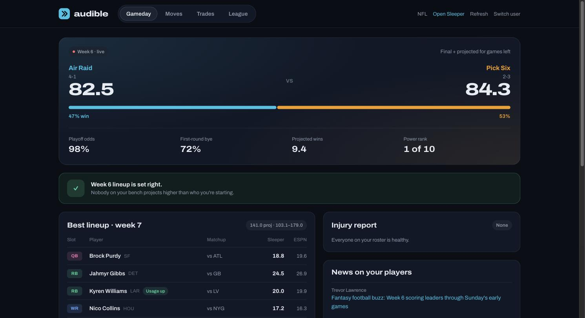
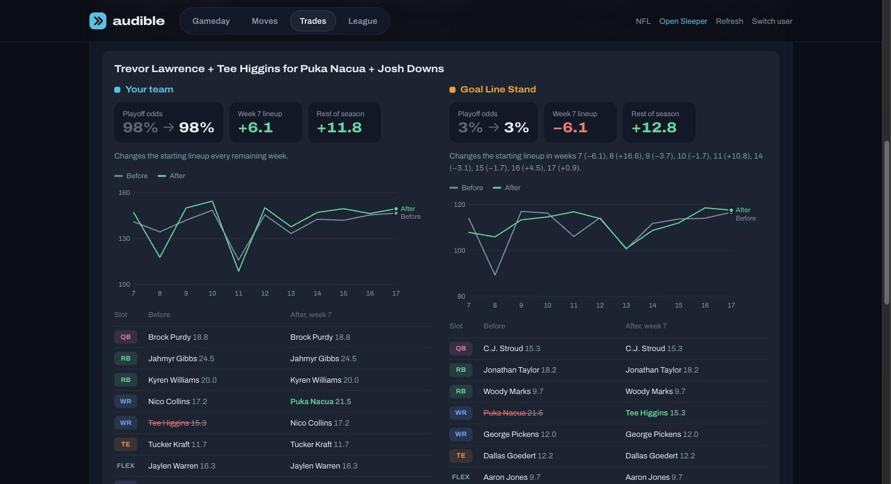
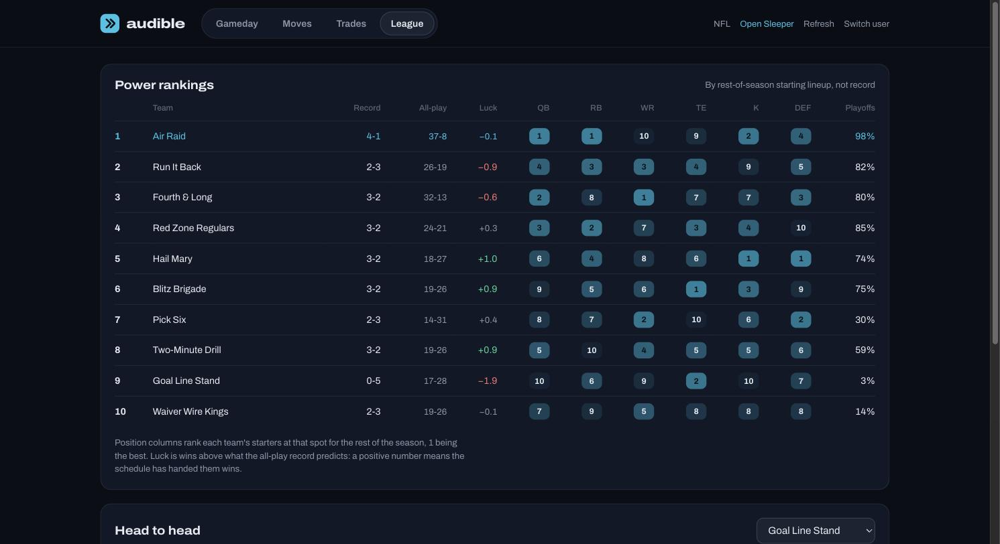

# audible

Read your Sleeper fantasy football league and call the play: fix your lineup, find
the pickups and trades worth making, and see exactly what each move does before you
make it.

**[Open it in your browser](https://nakulpatel0306.github.io/audible/)** · **[Read the guide](docs/GUIDE.md)**



Type in a Sleeper username and Audible reads that league: rosters, scoring rules,
schedule, projections, Vegas lines, injuries and news. It's free, needs no account or
API key, and is **read-only**. Sleeper's API can't change rosters, so Audible tells
you the move and you make it in Sleeper.

## What it does

| Tab     | What you get                                                                                               |
| ------- | ---------------------------------------------------------------------------------------------------------- |
| Gameday | This week's matchup and win odds, a lineup check, your best lineup, injury report, news on your players    |
| Moves   | Waiver pickups ranked by what they add to your lineup, defense and kicker streaming by matchup             |
| Trades  | Deals where both teams' lineups improve, plus a trade builder to grade your own ideas                      |
| League  | Power rankings, position-by-position ranks, all-play records and luck, playoff odds, head-to-head compare |

Every pickup and trade opens a **before and after**: playoff odds, next week's lineup,
rest-of-season points, a week-by-week chart, and which starters change. Trades show
both teams.





## Run it yourself

```sh
bun install
bun dev
```

Open the local URL and enter a Sleeper username. If that user is in more than one
league, Audible picks their first in-season league.

## Use the CLI

The same analysis, in the terminal:

```sh
bun cli/index.ts report --user <sleeper-username>
bun cli/index.ts trade --user <sleeper-username> --give "Player A,Player B" --get "Player C"
```

`--league <id>` picks a specific league. `SLEEPER_USERNAME` and `SLEEPER_LEAGUE_ID`
work in place of the flags.

## Where the numbers come from

| Source                         | Used for                                                           |
| ------------------------------ | ------------------------------------------------------------------ |
| Sleeper (Rotowire) projections | Every projected point, scored with the league's exact rules        |
| ESPN projections               | A second opinion; widens the range when it disagrees with Sleeper  |
| DraftKings lines, via ESPN     | Implied team totals, once books post the week's lines              |
| nflverse weekly stats          | Target share and carries trends ("Usage up" / "Usage down")        |
| ESPN news                      | Stories about players on your roster                               |

Nothing changes a projection unless it predicted better in a backtest on real 2026
results:

- **League scoring** reproduces Sleeper's official weekly team totals exactly.
- **Recent-form adjustments** made predictions worse (average miss 5.14 → 5.25
  points), so they're out.
- **Averaging Sleeper and ESPN** didn't help out of sample (5.506 vs 5.505 average
  miss over 1,073 player-weeks, holding out one week at a time). But when the two
  disagree, outcomes really are less predictable: the most-split quarter missed by
  65% of projection, the least-split by 50%. So disagreement widens a player's range,
  which flows into win and playoff odds, and shows as **Sources split**.
- **Usage trends and Vegas totals** are shown as context, not added to projections:
  the projections already price them in.

[docs/GUIDE.md](docs/GUIDE.md) explains every number on screen.

## Hosting

The [Pages workflow](.github/workflows/pages.yml) builds the app and deploys it to
GitHub Pages on every push, and again daily to refresh the nflverse usage data. Fork
the repo, set **Settings → Pages → Source** to **GitHub Actions**, and it runs at
`https://<you>.github.io/audible/`.

nflverse files can't be fetched by a browser directly, so the dev server proxies them
and the Pages build saves a copy next to the site
([`scripts/nflverse.ts`](scripts/nflverse.ts)). Everything else is fetched live from
the browser.

## Development

```sh
bun test         # scoring, lineups, waivers, trades, simulation, data parsing
bun run lint
bun run typecheck
bun run build
```

`src/core` is plain TypeScript shared by the web app and the CLI; `src/ui` is the
React app. See [CONTRIBUTING.md](CONTRIBUTING.md).

## License

[MIT](LICENSE). Not affiliated with Sleeper, ESPN, DraftKings or nflverse.
