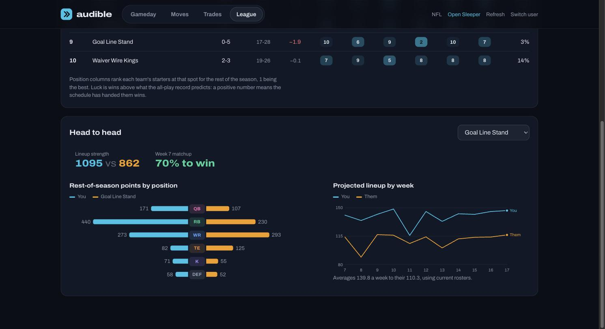

# Reading Audible

What every number means and how it's worked out. All points are in your league's own
scoring.

## Gameday

**Matchup.** While a week is being played, the scores are points already scored plus
projections for players whose games haven't started. Before kickoff they're pure
projections. The win bar is the chance your score ends higher, from each lineup's
projected total and its spread.

**Playoff odds, bye, projected wins.** The rest of the regular season is played out
10,000 times with current rosters. Teams are seeded by wins, then points scored, the
way Sleeper does it. "First-round bye" only appears for 6-team brackets, where the top
two seeds sit out round one.

**Power rank.** Where your team ranks by rest-of-season lineup strength (see League).

**Lineup check.** Compares the lineup you have set in Sleeper with the best one by
projection, and flags byes, injured starters and better bench options. Players whose
game has already kicked off are locked, so they're left out.

**Best lineup.** The highest-projected legal lineup for the next week you can still
change. The range under the title covers a typical week, one standard deviation either
side.

- **Sleeper / ESPN:** each source's projection. Sleeper's is the one Audible uses.
- **Sources split:** the two disagree by 20% or more. Those players have been less
  predictable, so their range is wider.
- **Usage up / down:** target share moved 5+ points, or carries moved 4+ a game, over
  the last three games compared with earlier in the season. Hover for the numbers.
- **Team total:** the points Vegas expects that player's team to score. It appears
  once sportsbooks post the week's lines, usually early in the week.

**Win chances.** Your odds in every remaining regular-season game.

## Moves

**Waiver pickups.** Each free agent is paired with your least costly drop. "Rest of
season" is how many more starting-lineup points you'd score from now to week 17, with
later weeks counting a little less because projections get less reliable. A player who
never cracks your lineup adds nothing, however good he is.

**Streaming.** Defenses and kickers score mostly off the matchup, so Audible compares
the free agents' next three weeks to yours. It suggests a swap only when a free agent
projects at least 1.5 points better next week. For defenses, "Opp total" is the
opponent's Vegas team total: lower is better.

## Trades

**Trades both sides should take.** Every 1-for-1 through 2-for-2 deal with each team,
kept only if *both* starting lineups improve, sorted by the smaller of the two gains.
Those are the deals another manager has a reason to accept.

**Build a trade.** Pick players on each side to get the same before and after for any
deal.

## Before and after

Opened from any pickup or trade.

- **Playoff odds:** before → after, both simulated from the same random seed so the
  difference comes from the move, not noise.
- **Week N lineup / Rest of season:** the change in starting-lineup points.
- **Changes the starting lineup in…:** the weeks the move matters. Most moves only
  matter in a few, like a bye week.
- **Chart and table:** projected lineup points by week, and who enters or leaves the
  lineup (moving between slots doesn't count).

## League

**Power rankings.** Teams ordered by rest-of-season starting-lineup points, not
record.

- **Position columns:** each team's starters at that position, ranked 1 (best) to
  last.
- **All-play:** the record a team would have if it had played every other team every
  week so far.
- **Luck:** actual wins minus the wins its all-play record predicts. Positive means
  the schedule has handed it wins.

**Head to head.** Lineup strength, the odds of any remaining game between you,
rest-of-season points by position, and both projected lineups week by week. It
defaults to your next opponent.
